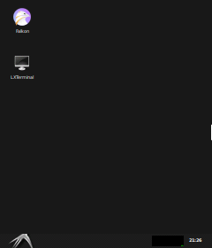
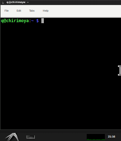

# Raspberry Pi ST7789 (240×280 IPS 1.69") Display & Driver Setup

[](https://www.raspberrypi.com/)
[](https://www.debian.org/)
[](https://www.waveshare.com/)
[](LICENSE)

Solución integral y automatizada para integrar pantallas **LCD IPS de 1.69 pulgadas (240×280 píxeles, controlador ST7789 / ST7789VW)** en Raspberry Pi con arquitectura **64-bit (aarch64)**.

Corrige los problemas clásicos de estos paneles: **eliminación de franjas negras y pantalla partida** por desfase de memoria, **corrección del efecto espejo horizontal**, **soporte para cristal biselado curvo (R-angle)**, **arranque ultra temprano (Early Boot)** desde el kernel y **miniaturización extrema del escritorio LXDE**.

---

## 📸 Capturas del Sistema en Ejecución

| Escritorio Miniaturizado (240×280) | Terminal LXDE Adaptada |
| :---: | :---: |
|  |  |
| *Iconos 20px, fuentes 6pt, barra 16px con padding lateral.* | *Ventanas confinadas al ancho visible sin desbordamiento.* |

---

## ⚡ Instalación Rápida (1 Comando)

Clona el repositorio en tu Raspberry Pi y ejecuta el instalador automatizado con privilegios de administrador:

```bash
git clone https://github.com/l707l/rpi-st7789-240x280-display.git
cd rpi-st7789-240x280-display
sudo ./install.sh
sudo reboot
```

El script se encarga automáticamente de:
1. Instalar dependencias y herramientas de compilación.
2. Modificar `/boot/firmware/config.txt` con la resolución nativa y timings HDMI/KMS.
3. Descargar, parchear y compilar `fbcp-ili9341` optimizado para ST7789 240×280 en ARM64.
4. Crear e iniciar el servicio `systemd` para arranque temprano inmediato.
5. Configurar `setup-display.sh`, LightDM, Openbox, LXPanel y PCManFM.

---

## 🔌 Conexión de Pines (Pinout SPI de 8 Pines)

| Pin Pantalla | Nombre Función | Pin Físico Raspberry Pi (GPIO) | Detalle / Función |
| :---: | :---: | :---: | :--- |
| **GND** | Ground | **Pin 6 o 9** (GND) | Tierra |
| **VCC** | Power | **Pin 1 o 17** (3.3V) | Alimentación 3.3V |
| **SCL** | SPI Clock | **Pin 23** (GPIO 11 / SPI0 SCLK) | Reloj SPI |
| **SDA** | SPI MOSI | **Pin 19** (GPIO 10 / SPI0 MOSI) | Datos SPI |
| **RES** | Reset | **Pin 18** (GPIO 24) | Reinicio por hardware |
| **DC** | Data / Command | **Pin 22** (GPIO 25) | Selector Datos/Comandos |
| **CS** | Chip Select | **Pin 24** (GPIO 8 / SPI0 CE0) | Habilitación de bus |
| **BLK** | Backlight | **Pin 27** (GPIO 0) o a **3.3V** | Control iluminación LED |

---

## 🧠 ¿Por qué esta solución es necesaria? (Detalles Técnicos)

### 1. Compensación de Memoria GRAM (240×320 vs 240×280)
El controlador ST7789 posee una memoria interna (GRAM) de **240×320**. Sin embargo, los paneles de 1.69" físicamente solo tienen cableadas **280 filas** (filas 20 a 299).
- Los drivers genéricos asumen pantallas de 240×240 y aplican un scroll de $320 - 240 = 80$ filas. Esto causa una **franja negra de 60 filas y divide la pantalla a la mitad**.
- **Nuestra solución:** Parchea el registro `VSCSAD` (comando `0x37`) a exactamente **20 filas** (`SPI_TRANSFER(0x37, 0, 20);`), alineando el píxel `(0,0)` físico con la primera línea visible del cristal.

### 2. Corrección del Efecto Espejo (MADCTL Comando 0x36)
En paneles ST7789 verticales, si solo se activa el bit MY (`0x80`), las columnas se leen de forma invertida, produciendo un efecto espejo donde el texto aparece reflejado de derecha a izquierda.
- **Nuestra solución:** Activa el bit MX (`MADCTL_COLUMN_ADDRESS_ORDER_SWAP` = `0x40`) resultando en `0xC0` (`MY=1, MX=1`). Esto restablece el sentido natural de lectura sin alterar el alineamiento de las 280 líneas.

### 3. Alineación de Memoria DMA en ARM64 (Debian 12 / 13 aarch64)
En sistemas de 64 bits, las instrucciones vectoriales de copia (`NEON` / `memcpy`) sobre memoria de hardware no cacheada (`/dev/mem`) provocan fallos de alineación (`SIGBUS / Bus Error`).
- **Nuestra solución:** Implementa una rutina de copia escalar de 32 bits (`uncached_memcpy`) y lectura segura de registros de temporizador de 64 bits en `dma.cpp` y `tick.h`.

### 4. Bisel Curvo de Cristal (R-Angle)
Las esquinas redondeadas del panel de 1.69" ocultan los primeros y últimos 8 píxeles de los extremos:
- **Nuestra solución:** Se configuraron espaciadores invisibles de **8px** a la izquierda y derecha en `lxpanel` (`Plugin { type=space Config { Size=8 } }`). El menú Inicio y el reloj quedan protegidos en el área plana del cristal.

### 5. Arranque Temprano Inmediato (Early Boot)
El servicio `/etc/systemd/system/fbcp.service` utiliza `DefaultDependencies=no` y se posiciona antes de `sysinit.target`:
- La pantalla enciende desde el segundo 1 de arranque del kernel, mostrando logs de inicio y consola sin esperar a que cargue el entorno gráfico.

---

## 📊 Rendimiento, Benchmark y Optimización de Bus SPI

El bus SPI0 de la Raspberry Pi opera derivado de `core_freq=400 MHz` mediante divisores pares enteros (`Frecuencia = core_freq / DIVISOR`). Para un panel de **240×280** en formato **RGB565 (16 bits/px)**, cada cuadro completo requiere transferir **1,075,200 bits (~1.075 Mbit o 134.4 KB)**.

A continuación se detalla la comparativa real y teórica obtenida en las pruebas de optimización:

| Velocidad SPI | Divisor | Ancho de Banda Teórico | FPS Teóricos (100% Pantalla) | FPS Reales (Diffing `fbcp`) | Estabilidad / Observaciones |
| :---: | :---: | :---: | :---: | :---: | :--- |
| **13.33 MHz** | 30 | 13.33 Mbps | ~12.4 FPS | 35 – 50 FPS | Configuración legacy por defecto; lenta en video. |
| **40.00 MHz** | 10 | 40.00 Mbps | ~37.2 FPS | 50 – 60 FPS | **Plan de contingencia:** 100% sólida incluso con cables largos o ruidosos. |
| **50.00 MHz** | **8** | **50.00 Mbps** | **~46.5 FPS** | **60 FPS constantes** | **Configuración Óptima (Sweet Spot):** Máximo beneficio, frío y dentro de norma. |
| **66.67 MHz** | 6 | 66.67 Mbps | ~62.0 FPS | 60 FPS constantes | Supera el límite de fábrica de 62.5 MHz del ST7789VW; beneficio extra marginal. |
| **100.00 MHz** | 4 | 100.00 Mbps | ~93.0 FPS | 60 FPS (tope GPU) | Overclock extremo; produce desincronización y ruido térmico. |

### 🏆 ¿Por qué Divisor 8 (50.00 MHz) maximiza beneficios?
1. **Saturación de 60 FPS:** Dado que la GPU Raspberry Pi emite a 60 Hz y el motor diff solo transfiere las áreas que cambian, 50 MHz proporciona suficiente margen para mantener **60 FPS progresivos (`60p`)** sin recurrir a entrelazado (*interlacing*).
2. **Dentro de Especificación Oficial:** El controlador ST7789VW especifica un tiempo de ciclo mínimo de escritura de 16 ns (máx. 62.5 MHz). Operar a 50 MHz garantiza cero ruido de señal, bordes limpios y fiabilidad a largo plazo.
3. **Monitoreo en Tiempo Real (`-DSTATISTICS=1`):** Se activa el contador de FPS en la esquina superior izquierda de forma limpia, mostrando la tasa de cuadros (`60p`) y velocidad de transferencia sin gráficas invasivas.

---

### 🔄 Cambio Rápido de Frecuencia (Sin reinstalar todo)

Si necesitas alternar entre frecuencias o probar la contingencia de 40 MHz, ejecuta en la Raspberry Pi:

```bash
# Cambiar a 50 MHz (Recomendado):
cd ~/fbcp-ili9341/build
cmake -DST7789VW=ON -DSPI_BUS_CLOCK_DIVISOR=8 -DDISPLAY_WIDTH=240 -DDISPLAY_HEIGHT=280 -DSTATISTICS=1 ..
make -j$(nproc)
sudo systemctl stop fbcp.service && sudo cp fbcp-ili9341 /usr/local/bin/fbcp && sudo systemctl start fbcp.service

# Contingencia rápida a 40 MHz (si usas cables muy largos):
cd ~/fbcp-ili9341/build
cmake -DST7789VW=ON -DSPI_BUS_CLOCK_DIVISOR=10 -DDISPLAY_WIDTH=240 -DDISPLAY_HEIGHT=280 -DSTATISTICS=1 ..
make -j$(nproc)
sudo systemctl stop fbcp.service && sudo cp fbcp-ili9341 /usr/local/bin/fbcp && sudo systemctl start fbcp.service
```

---

## 🛠️ Herramientas de Depuración Incluidas

El repositorio incluye herramientas para capturar el búfer de pantalla directamente desde VideoCore DispmanX:
- `tools/dump_dispmanx.c`: Vuelca el búfer nativo de GPU a un archivo RAW.
- `tools/raw2png.py`: Convierte el búfer RGB565 a una imagen PNG limpia.

---

## 📄 Licencia

Este proyecto se distribuye bajo la licencia **MIT**. Basado en el proyecto original `fbcp-ili9341` de Jukka Jylänki (`juj`).
